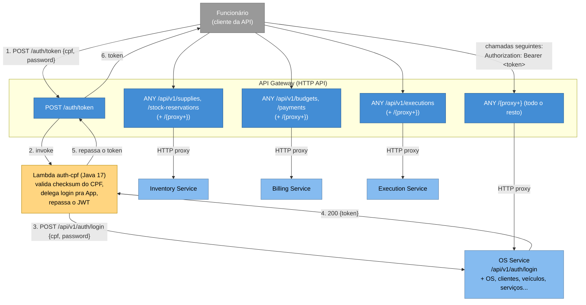

# fiap-tech-challenge-API-gateway-function-serverless

Porta de entrada única (API Gateway) e autenticação via CPF (Function Serverless) do Tech Challenge — FIAP Pós-Tech, Arquitetura de Software, turma 15SOAT. É a entrada única do sistema e **roteia cada prefixo da API para o serviço dono dele** (OS, Inventory, Billing e Execution).

## Tecnologias

| Camada | Tecnologia |
|---|---|
| Function Serverless | Java 17, Maven, `aws-lambda-java-core`/`events`, Jackson |
| Porta de entrada | Amazon API Gateway (HTTP API) |
| Provisionamento | Terraform >= 1.5, provider `hashicorp/aws` |
| Nuvem | AWS (conta acadêmica AWS Academy Learner Lab) |
| CI/CD | GitHub Actions |

## Arquitetura



**Decisões de desenho** (ADRs/RFCs completos centralizados no repositório da App, pasta [`docs/`](https://github.com/Adriana-Meyer/fiap-tech-challenge-os-service/tree/main/docs)):
- **Java em vez de Node.js**: a Lambda é deliberadamente fina (valida CPF, faz uma chamada HTTP, repassa a resposta) — sem framework (nada de Spring), pra não pagar cold start de um contexto de aplicação numa função tão simples. A escolha de Java (em vez de uma opção "mais simples" de runtime leve como Node/Python) foi por consistência com o resto do projeto e também como oportunidade de aprendizado da linguagem Java.
- **Lambda consulta a própria App, não é um Lambda Authorizer**: a Lambda só participa da emissão do token (rota `/auth/token`); todas as outras rotas passam direto (HTTP proxy) pra App, que continua validando o JWT e os papéis (RBAC) exatamente como antes. Evita duplicar lógica de segurança fora da App.
- **Validação de CPF duplicada, não compartilhada via lib**: o algoritmo de checksum existe tanto aqui (`lambda/auth/.../CpfValidator.java`) quanto na App (`domain/model/shared/CpfValidator.java`) — decisão consciente de não criar uma biblioteca compartilhada entre repositórios, para manter os 4 repositórios genuinamente independentes (sem acoplar o build de um ao artefato publicado por outro).
- **Roteamento por prefixo:** cada serviço tem o seu load balancer, e o gateway manda cada prefixo para o dono dele. O que não está na lista pertence ao OS, que continua sendo a rota padrão (`ANY /{proxy+}`). A lista de prefixos vem dos `@RequestMapping` dos controllers de cada serviço:

  | Prefixo | Serviço |
  |---|---|
  | `/api/v1/supplies`, `/api/v1/stock-reservations` | Inventory |
  | `/api/v1/budgets`, `/api/v1/payments` | Billing |
  | `/api/v1/executions` | Execution |
  | todo o resto (`/api/v1/service-orders`, `customers`, `vehicles`, `services`, `tracking`, `auth`, `webhooks`, Swagger, actuator) | OS |

- **Duas rotas por prefixo:** `/prefixo/{proxy+}` **não** casa com `/prefixo` (a variável gananciosa exige mais um segmento), e listar ou criar é exatamente `GET`/`POST /api/v1/supplies`. Por isso cada prefixo tem a rota exata e a rota com `{proxy+}`. O API Gateway escolhe a rota mais específica, então elas vencem a rota padrão do OS. O caminho chega ao serviço sem alteração.
- **Quem valida o JWT continua sendo cada serviço:** o gateway só roteia. Os quatro compartilham o segredo de assinatura do OS e aplicam os próprios perfis.
- **Hosts dos serviços descobertos pelo workflow, não copiados à mão:** com 4 serviços, copiar 4 hosts a cada sessão do Lab seria frágil. O `terraform-apply.yml` roda `scripts/discover-service-hosts.sh`, que lê o host de cada `Service` no cluster e entrega o resultado ao Terraform em `TF_VAR_service_hosts`. O Terraform continua recebendo os hosts como **variável** (sem `data source`), então dá para usá-lo à mão também. Substitui a variável manual `app_backend_host` e o secret `APP_BACKEND_HOST`, que deixa de ser usado.
- **Swagger:** continua acessível pelo gateway só para o OS; o dos outros serviços fica no load balancer de cada um.

## Pré-requisitos

- Java 17+ e Maven (para buildar a Lambda)
- Terraform >= 1.5
- Conta AWS Academy Learner Lab **ativa** (sessão de 4h) com credenciais temporárias exportadas
- Os 4 serviços (OS, Inventory, Billing e Execution) já com deploy feito (`deploy-aws.yml`), cada um com o seu load balancer

## Executando

```bash
# 1. Testar e empacotar a Lambda
cd lambda/auth
mvn test
mvn package
cd ../..

# 2. Provisionar Lambda + API Gateway
export AWS_ACCESS_KEY_ID=...
export AWS_SECRET_ACCESS_KEY=...
export AWS_SESSION_TOKEN=...
export TF_VAR_service_hosts='{"os":"<host>","inventory":"<host>","billing":"<host>","execution":"<host>"}'
# ou, com o kubectl apontando para o cluster, deixar o script descobrir:
#   aws eks update-kubeconfig --region us-east-1 --name tech-challenge-eks
#   export TF_VAR_service_hosts="$(bash scripts/discover-service-hosts.sh)"

terraform init
terraform plan
terraform apply

# 3. Testar o fluxo de autenticação por CPF
curl -X POST "$(terraform output -raw auth_token_endpoint)" \
  -H "Content-Type: application/json" \
  -d '{"cpf": "11144477735", "password": "workshop123"}'
```

Para desativar tudo ao final da sessão do Lab (economiza orçamento do Lab):

```bash
terraform destroy
```

## CI/CD

- **`terraform-validate.yml`** — roda em todo push/PR para `develop`/`main`: builda e testa a Lambda (`mvn package`), depois `terraform fmt -check`, `terraform init -backend=false`, `terraform validate`. Não precisa de credenciais AWS.
- **`terraform-apply.yml`** — disparo manual (`workflow_dispatch`), com escolha entre `plan`/`apply`/`destroy`. Builda a Lambda, **descobre os hosts dos 4 serviços no cluster** (`scripts/discover-service-hosts.sh`: falha dizendo quais serviços ainda não têm load balancer; no `destroy` é pulado, porque os serviços costumam já ter sido desligados) e roda o Terraform contra a AWS de verdade, usando credenciais temporárias da sessão AWS Academy via GitHub Secrets (`AWS_ACCESS_KEY_ID`, `AWS_SECRET_ACCESS_KEY`, `AWS_SESSION_TOKEN`) — precisam ser atualizadas a cada nova sessão do Lab. Fica `workflow_dispatch` manual permanentemente, inclusive no estado final entregue: essa é a alternativa adotada para economizar os recursos limitados do Lab (sessão de ~4h) — o deploy em si é automático de ponta a ponta assim que disparado, sem nenhuma intervenção manual durante a execução; só o gatilho é manual, para ser acionado quando for conveniente e a sessão do Lab estiver ativa.

## Variáveis Terraform

| Variável | Descrição |
|---|---|
| `service_hosts` | **Obrigatória**, sem default. Objeto com o host (e porta opcional, sem `http://` nem caminho) do load balancer de cada serviço: `os`, `inventory`, `billing`, `execution`. O workflow preenche sozinho |
| `aws_region` | Default `us-east-1` |
| `project_name` | Default `tech-challenge` |

## APIs

- Rota de autenticação: `POST /auth/token` — ver exemplo de `curl` acima.
- As demais rotas são as documentadas no Swagger de cada serviço (OS: [os-service](https://github.com/Adriana-Meyer/fiap-tech-challenge-os-service#documenta%C3%A7%C3%A3o-da-api-swagger-ui); Inventory, Billing e Execution nos READMEs dos repositórios deles), acessadas pela URL deste API Gateway em vez de direto no load balancer. A saída `terraform output routes` mostra para onde cada rota envia a requisição.

## Como foi validado

O LocalStack gratuito não emula o API Gateway v2, então o roteamento **não** foi executado de ponta a ponta fora da AWS. O que foi verificado:

- `terraform fmt`, `validate` e `actionlint` passam.
- Um `plan` offline com os hosts descobertos cria as 12 rotas esperadas, com as integrações certas, e rejeita hosts com `http://` ou caminho e um serviço faltando.
- As rotas e URIs do plano foram conferidas contra as regras de precedência do API Gateway: 25 requisições de exemplo (inclusive prefixos parecidos, como `/suppliesX` e `/payments-report`, que **não** podem ser capturados) caem no serviço e no caminho certos.
- Os prefixos foram cruzados com os `@RequestMapping` reais dos controllers dos 4 serviços: nenhum ficou de fora nem colide.
- O script de descoberta foi executado contra um cluster `kind` com os 4 `Service`: sem load balancer, com um faltando, com um namespace apagado, com todos prontos e no modo `destroy` com o cluster inacessível.

**Não validado:** o roteamento real no API Gateway, a Lambda chamando o login do OS pelo novo host, e o `apply` na AWS. Entram na validação no Lab.
